# PulseIQ star schema

The warehouse lives in the `wh` schema of `pulseiq.duckdb`. Each fact table sits in the middle and points to its dimension tables with keys.

- **PK** = primary key (unique id of a row). **FK** = foreign key (points to a row in another table).
- `dim_employee` keeps history (SCD Type 2). Each version of a person has its own `employee_key`, so a person who changed department is counted in the right department for each month.
- `fact_ledger.cost_center_department_id` may be blank (balance-sheet lines have no cost centre), shown with a dotted-end line.
- Keys are not enforced as foreign keys in the database on purpose, so that the orphan check can find and report problems instead of the load failing.

```mermaid
erDiagram
  dim_date {
    int date_key PK
    string year_month
  }
  dim_employee {
    int employee_key PK
    string department_id FK
    string role_id FK
    string work_location FK
    string employee_id "business id, same for all versions"
    date valid_from
    date valid_to
    string is_current
  }
  dim_department {
    string department_id PK
  }
  dim_role {
    string role_id PK
    string department_id FK
  }
  dim_location {
    string work_location PK
  }
  dim_leave_type {
    string leave_type_code PK
  }
  dim_account {
    int account_code PK
  }
  dim_client {
    string client_id PK
  }
  dim_vendor {
    string vendor_id PK
  }
  dim_team {
    string team_id PK
    string department_id FK
  }
  dim_sprint {
    string sprint_id PK
  }
  fact_payroll {
    string payroll_item_id PK
    int employee_key FK
    int date_key FK
    string department_id FK
    string role_id FK
  }
  fact_attendance_monthly {
    string attendance_fact_id PK
    int employee_key FK
    int date_key FK
    string department_id FK
  }
  fact_leave {
    string leave_request_id PK
    int employee_key FK
    string leave_type_code FK
    int start_date_key FK
    int end_date_key FK
  }
  fact_headcount_monthly {
    int date_key PK, FK
    string department_id PK, FK
  }
  fact_ledger {
    string line_id PK
    int account_code FK
    string cost_center_department_id FK
    int date_key FK
  }
  fact_invoice {
    string invoice_id PK
    string client_id FK
    int service_line_account FK
    int invoice_date_key FK
  }
  fact_invoice_payment {
    string payment_id PK
    string invoice_id FK
    int payment_date_key FK
  }
  fact_expense {
    string expense_id PK
    string vendor_id FK
    int category_account FK
    string department_id FK
    int expense_date_key FK
  }
  fact_task {
    string task_id PK
    string team_id FK
    string sprint_id FK
    int assignee_employee_key FK
  }
  fact_anomaly {
    string result_id PK
    int employee_key FK
    int period_key FK
  }
  fact_attrition_risk {
    string prediction_id PK
    int employee_key FK
    string department_id FK
    int as_of_date_key FK
  }
  fact_forecast {
    string forecast_id PK
    int forecast_month_key FK
    string department_id FK
  }
  dim_employee }o--|| dim_department : "department_id"
  dim_employee }o--|| dim_role : "role_id"
  dim_employee }o--|| dim_location : "work_location"
  dim_role }o--|| dim_department : "department_id"
  dim_team }o--|| dim_department : "department_id"
  fact_payroll }o--|| dim_employee : "employee_key"
  fact_payroll }o--|| dim_date : "date_key"
  fact_payroll }o--|| dim_department : "department_id"
  fact_payroll }o--|| dim_role : "role_id"
  fact_attendance_monthly }o--|| dim_employee : "employee_key"
  fact_attendance_monthly }o--|| dim_date : "date_key"
  fact_attendance_monthly }o--|| dim_department : "department_id"
  fact_leave }o--|| dim_employee : "employee_key"
  fact_leave }o--|| dim_leave_type : "leave_type_code"
  fact_leave }o--|| dim_date : "start_date_key"
  fact_leave }o--|| dim_date : "end_date_key"
  fact_headcount_monthly }o--|| dim_department : "department_id"
  fact_headcount_monthly }o--|| dim_date : "date_key"
  fact_ledger }o--|| dim_account : "account_code"
  fact_ledger }o--o| dim_department : "cost_center_department_id"
  fact_ledger }o--|| dim_date : "date_key"
  fact_invoice }o--|| dim_client : "client_id"
  fact_invoice }o--|| dim_account : "service_line_account"
  fact_invoice }o--|| dim_date : "invoice_date_key"
  fact_invoice_payment }o--|| fact_invoice : "invoice_id"
  fact_invoice_payment }o--|| dim_date : "payment_date_key"
  fact_expense }o--|| dim_vendor : "vendor_id"
  fact_expense }o--|| dim_account : "category_account"
  fact_expense }o--|| dim_department : "department_id"
  fact_expense }o--|| dim_date : "expense_date_key"
  fact_task }o--|| dim_team : "team_id"
  fact_task }o--|| dim_sprint : "sprint_id"
  fact_task }o--|| dim_employee : "assignee_employee_key"
  fact_anomaly }o--|| dim_employee : "employee_key"
  fact_anomaly }o--|| dim_date : "period_key"
  fact_attrition_risk }o--|| dim_employee : "employee_key"
  fact_attrition_risk }o--|| dim_department : "department_id"
  fact_attrition_risk }o--|| dim_date : "as_of_date_key"
  fact_forecast }o--|| dim_date : "forecast_month_key"
  fact_forecast }o--|| dim_department : "department_id"
```

